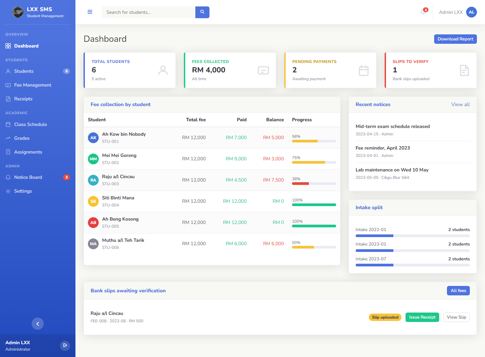
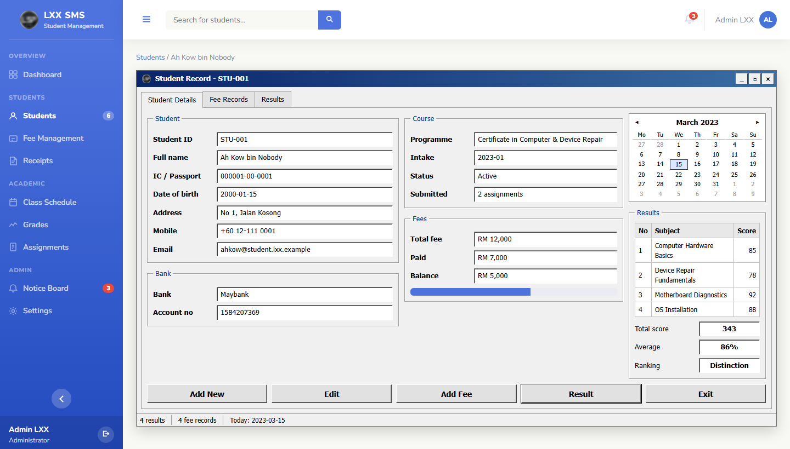
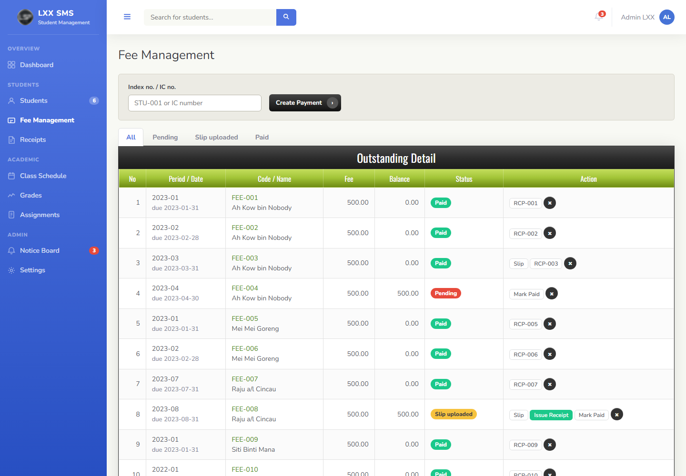
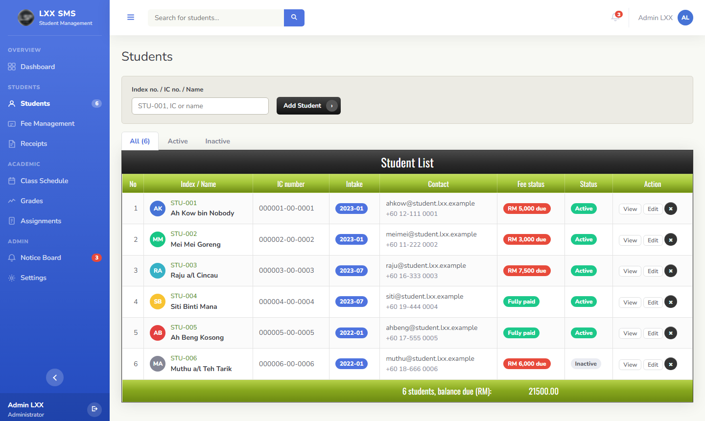
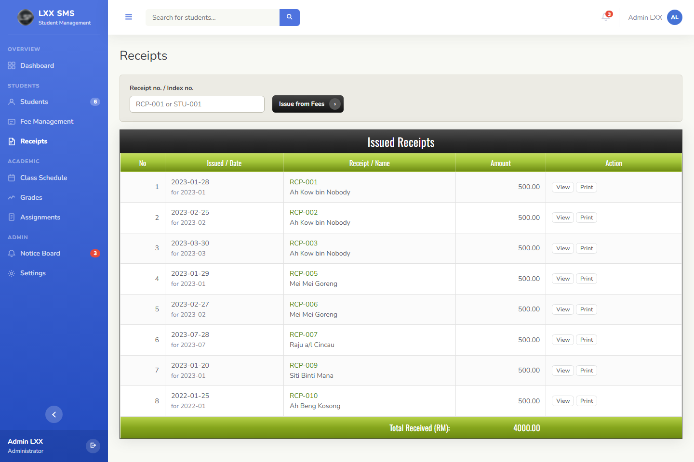
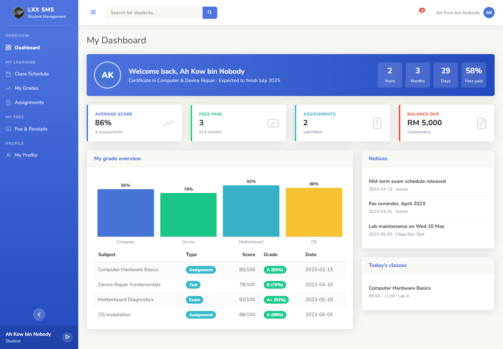
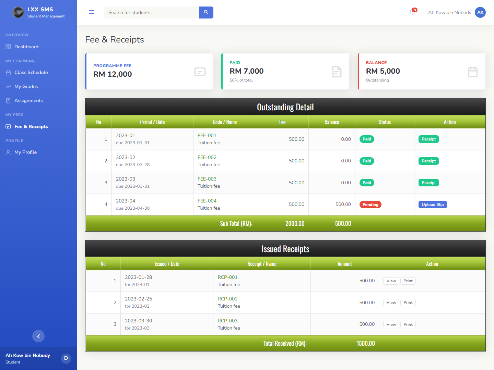

# Student Management System

A student management system I built during my Diploma internship, for the repair course run by a Malaysian company.

> To protect the privacy of the company I interned with, its name and logo have been blurred throughout this project.



## Overview

Admin staff, teachers and students each log in to their own view. Admin keeps student records, creates fee payments, checks bank slips and issues receipts. Teachers manage classes, grades and assignments. Students see their schedule, results and fees, upload payment slips and hand in assignments.

The version used at the company stored its data in MySQL. This public demo keeps the data in the browser's `localStorage` instead, so it runs without a server or database.

The look mixes a 2022 admin dashboard style with two older screens: a Windows form for the student record, and a glossy web 2.0 table for fees and receipts.

All students, IC numbers and bank accounts are made-up demo data.

## Internship

| | |
|---|---|
| Programme | Diploma in Electronic Engineering (Computer) |
| Institution | Sultan Azlan Shah Polytechnic, Behrang |
| Internship period | 29 January 2024 to 14 June 2024 |

## Features

| Role | What it does |
|---|---|
| Admin | Dashboard with fee collection and intake split. Add, edit, search and delete students. Student record window with fees, results, total score and ranking |
| Admin | Create fee payments, mark as paid, view bank slips and issue official receipts. Print receipts. Download a fee report as CSV |
| Admin | Class schedule by intake, grades, assignments with submissions, notice board, reset to demo data |
| Teacher | Own schedule, add grades, post assignments and grade submissions, see students' average scores |
| Student | Course countdown, grade chart, class schedule, submit assignments, upload payment slips, view receipts, print a transcript |
| All | Collapsible sidebar (icons only), choice kept in the browser |

## Screenshots

| Student record | Fee management |
|---|---|
|  |  |

| Students | Receipts |
|---|---|
|  |  |

| Student dashboard | Student fees |
|---|---|
|  |  |

## Technologies

- HTML, CSS and plain JavaScript, no framework and no build step
- MySQL for data in the original company version
- `localStorage` for data in this public demo
- Google Fonts (Nunito, Oswald)

## Getting Started

| Step | How |
|---|---|
| Run | Open `index.html` in a browser |
| Admin | `admin@lxx.example` / `admin123` |
| Teacher | Pick the Teacher tab, any password |
| Student | Pick the Student tab, any password |
| Reset data | Settings → **Reset to Demo Data** |

## Directory Structure

```
Student Management System/
├── index.html          # login, layout and modals
├── style.css           # theme, windows form and glossy tables
├── app.js              # data, pages and actions
└── docs/screenshots/   # images for this README
```

## Development Notes

- Each page is drawn by a `render...` function listed in `PAGES` in `app.js`.
- Shared parts such as grade tables, the schedule grid and the fee table are small builder functions, so pages stay short.
- Uploaded slips and assignment files are kept as data URLs in the browser for the demo only.

## Copyright

© 2024 cheah20. All rights reserved.

This project is shared for portfolio viewing only. Please do not copy, reuse or submit it as your own work. See [LICENSE](LICENSE).
